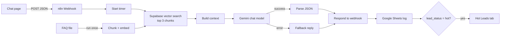

# Lakshay India Enquiry Chatbot (demo)

An AI enquiry assistant for a career counselling company, built with **n8n**, **Supabase (pgvector)** and **Google Gemini**.
It answers questions from a knowledge base (RAG), qualifies leads, and logs every conversation to Google Sheets.

> **Unofficial demo.** Built by Umer Rehman using only public information from lakshayindia.com. It is not an official Lakshay India product.

## What it does

- **Answers from a knowledge base (RAG):** a question is embedded, the 3 closest FAQ chunks are retrieved from Supabase, and Gemini answers only from that context.
- **Refuses to guess:** if the answer is not in the knowledge base, it says so and points to the team's WhatsApp number.
- **Qualifies leads:** the model returns structured JSON (`name`, `course_interest`, `lead_status` of hot / warm / cold, `answer_found`, `next_step`).
- **Logs everything:** each enquiry is appended to Google Sheets with timestamp, reply, lead fields, latency and approximate token counts.
- **Routes hot leads:** hot leads are also written to a separate "Hot Leads" tab (the place where a CRM or WhatsApp alert would go).
- **Fails gracefully:** if the LLM call errors, the user gets a polite fallback message and the error is logged.

## Architecture



## Tech stack

- **n8n** (self-hosted) for orchestration, webhooks and error handling
- **Google Gemini** for embeddings (`gemini-embedding-001`) and the chat model
- **Supabase** (PostgreSQL + pgvector) as the vector store
- **Google Sheets** as a lightweight lead log (a CRM stand-in)
- **HTML / CSS / JavaScript** for the chat page

## Repository structure

```
frontend/index.html          chat page
workflows/                   exported n8n workflows (chat + ingestion)
database/schema.sql          documents table and match_documents function
knowledge-base/              FAQ written from public website content
.env.example                 credentials you need to create (no real values)
```

## Setup

1. **Supabase:** create a project and run `database/schema.sql` in the SQL Editor.
2. **n8n:** run `npx n8n`, then import the two workflows from `workflows/`.
3. **Credentials in n8n:** Google Gemini API key, Supabase (project URL + secret key) and Google Sheets (OAuth).
4. **Load the knowledge base:** run the ingestion workflow once to embed `knowledge-base/lakshay_india_faq.md` into Supabase. Running it twice creates duplicates.
5. **Google Sheet:** create a tab `Sheet1` with the columns `timestamp, name, message, reply, course_interest, lead_status, answer_found, tokens_in, tokens_out, latency_ms, error, next_step` and a tab `Hot Leads` with `timestamp, name, message, course_interest, next_step`.
6. **Publish** the chat workflow in n8n.
7. **Frontend:** set `WEBHOOK_URL` in `frontend/index.html` to your webhook address, or open the page with `?api=https://YOUR-HOST/webhook/enquiry` so the endpoint is not stored in the repository.

n8n's webhook must allow the page's origin (the Webhook node's *Allowed Origins (CORS)* option).

## Known limitations

- The n8n instance runs on a local machine, so a live demo needs that machine and a tunnel to be running.
- Gemini's free tier has small daily limits, so heavy use can trigger the fallback reply.
- Token counts are approximate (characters divided by 4), not exact usage figures.
- No conversation memory yet: each message is answered on its own.
- The knowledge base is small (written from public website pages) and does not cover pricing details or session booking.

## Ideas for extending it

These are design ideas, not implemented:

- Replace the webhook with a **WhatsApp Business API** trigger; everything after it stays the same.
- Replace the Google Sheets log with an HTTP request to a **CRM API**.
- Add conversation memory using the session ID the page already sends.
- Add a voice layer (speech-to-text, this same workflow, then text-to-speech).
